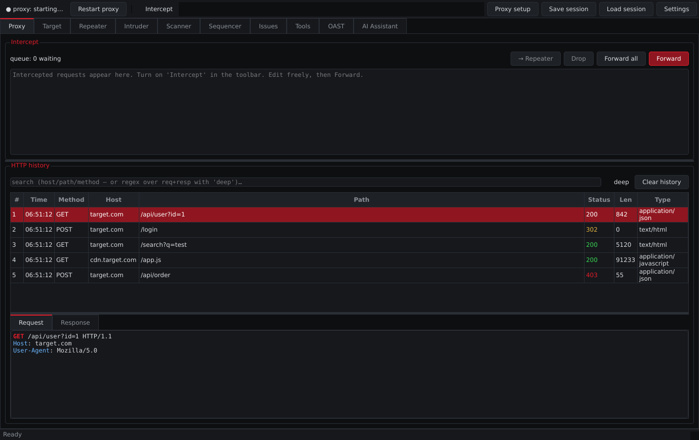
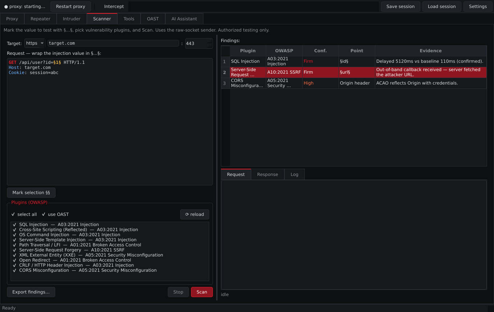
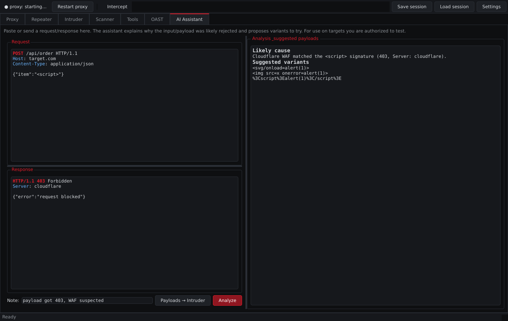
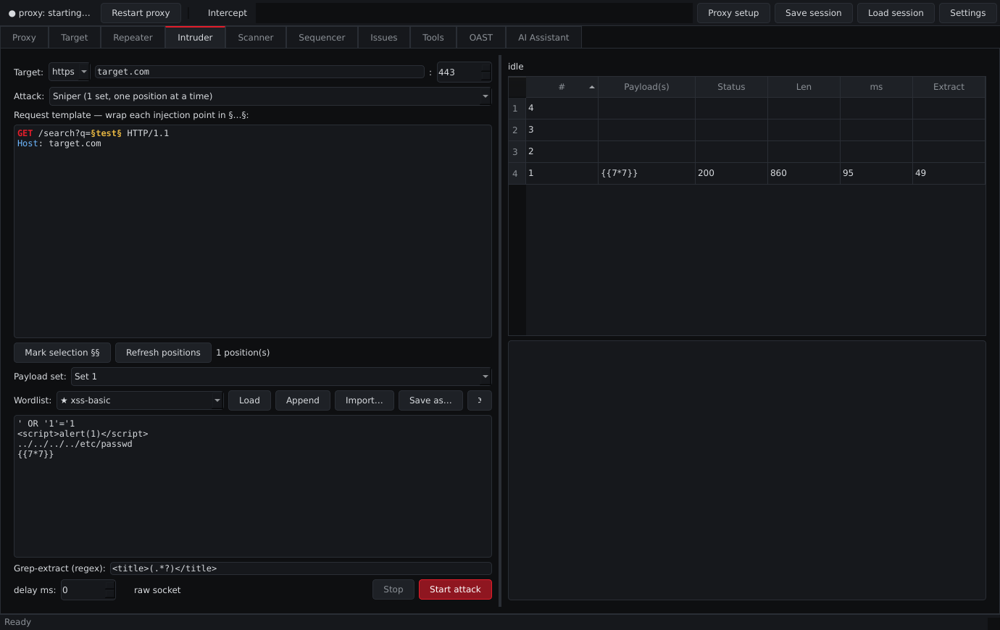
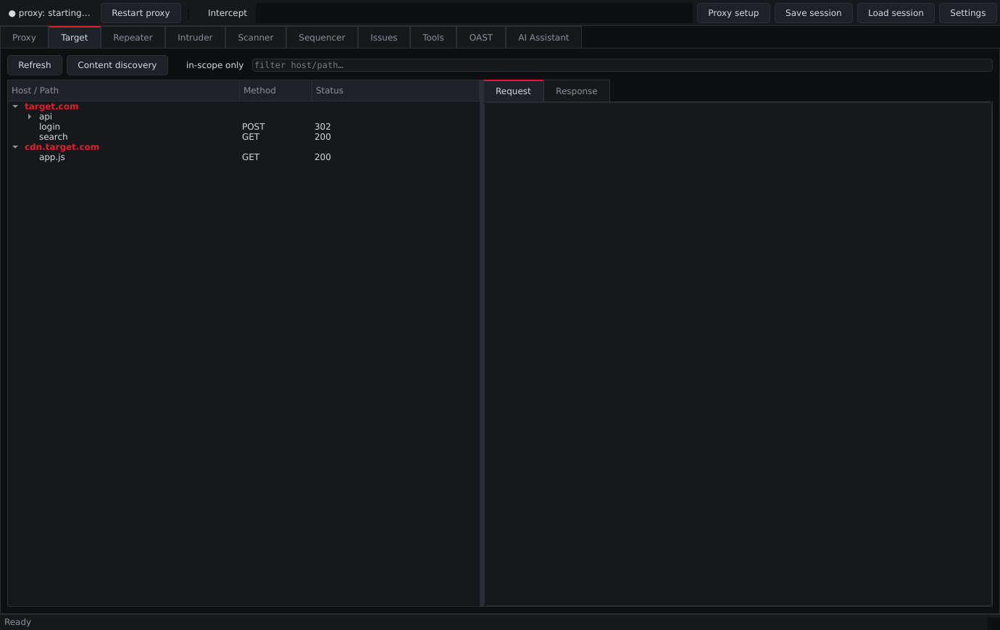
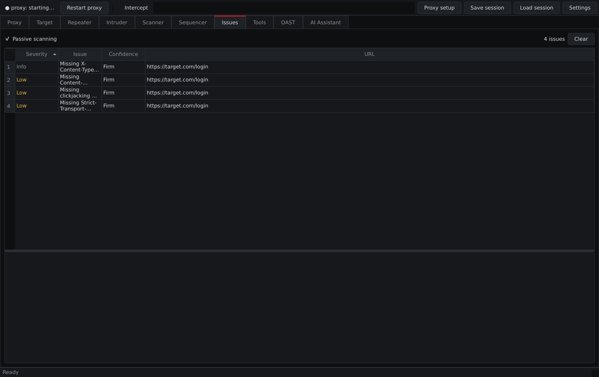

<div align="center">

# 🦅 r3dProxy

### An AI-assisted intercepting web proxy for authorized security testing

A lightweight, hackable, open-source alternative to Burp Suite — intercepting
proxy, OWASP scanner, Intruder, Sequencer, OAST, external-tool recon and
Obsidian reporting, with a **local, free AI** assistant built in.

[](https://github.com/0x1Ray/r3dProxy/actions/workflows/ci.yml)
[](LICENSE)
[](https://www.python.org/)
[](#)
[](https://doc.qt.io/qtforpython/)

[Features](#-features) · [Quick start](#-quick-start) · [AI setup](#-ai-assistant-required) ·
[Recon tools](#-external-recon-tools) · [Obsidian export](#-engagement-notes-obsidian) ·
[Scanner](#-scanner--owasp-plugins)

</div>

> [!WARNING]
> **Authorized testing only.** Use r3dProxy exclusively against systems you own
> or are explicitly permitted to assess. You are responsible for complying with
> all applicable laws.

---

r3dProxy is built on [mitmproxy](https://mitmproxy.org/) (proxy engine + TLS CA)
and [PySide6](https://doc.qt.io/qtforpython/) (GUI). Its AI assistant analyzes a
response and suggests how to modify a request when an input or payload gets
rejected — and by default it runs **locally and free** via Ollama + Qwen, so no
data leaves your machine and no API key is required.

## ✨ Features

| Area | What you get |
|---|---|
| **Proxy** | Intercepting HTTP/HTTPS proxy with a pause-and-edit **intercept queue** (forward / drop / forward-all) and an auto-generated CA |
| **HTTP history** | Searchable table with **deep regex search** across full request+response bodies; right-click → send anywhere |
| **Target** | Host → path **site map** tree with **scope** control and **content discovery** (hidden-path brute force, soft-404 calibrated) |
| **Repeater** | Multi-tab edit/resend, response viewer, optional **raw-socket** mode, one-click → AI |
| **Intruder** | Four attack types (**sniper · battering ram · pitchfork · cluster bomb**), multi-position payload sets, wordlists, **grep-extract** into a sortable column |
| **Scanner** | **10 OWASP plugins** with PortSwigger-style payloads and FP-reducing detection; extensible with your own plugins |
| **Issues** | **Passive auditing** while you browse: security headers, cookie flags, reflected input, stack traces, info disclosure, risky CORS |
| **Sequencer** | Token randomness analysis (entropy, duplicates, sequence & encoding detection) |
| **OAST** | Out-of-band callback listener to confirm **blind** SSRF/XXE/RCE — auto-used by the Scanner to upgrade findings to *Firm* |
| **Recon** | Drives real Linux tools: **nmap, nikto, nuclei, whatweb, wafw00f, httpx, ffuf, gobuster, feroxbuster, subfinder, amass, assetfinder…** |
| **Tools** | Decoder/Encoder (URL/Base64/Hex/HTML/JWT, pretty JSON/XML), response **Comparer**, **CSRF PoC** generator |
| **AI** | Pluggable assistant — **local Qwen (Ollama) by default**, or any OpenAI-compatible provider / Claude; suggests payloads straight into Intruder |
| **Reporting** | **Obsidian export**: one cross-linked note per asset (domain/subdomain/IP) with ports, tech, paths, findings — plus Markdown/JSON finding reports |
| **Workflow** | Match & Replace, scope, session save/load, built-in + user wordlists, dark *hawk* theme |

## 📸 Screenshots

| Proxy &amp; history | Scanner (OWASP plugins) |
|---|---|
|  |  |

| AI assistant | Intruder |
|---|---|
|  |  |

| Target site map | Passive issues |
|---|---|
|  |  |

## 🚀 Quick start

Requires **Python 3.10+** on Linux.

```bash
git clone https://github.com/0x1Ray/r3dProxy.git
cd r3dProxy

# 1) Python app
python3 -m venv .venv && source .venv/bin/activate
pip install -r requirements.txt

# 2) Install the AI runtime + external recon tools (see notes below)
bash scripts/install_tools.sh

# 3) Run
python run.py
```

If the window fails to start with an `xcb` plugin error, install your distro's
Qt deps (e.g. `sudo apt install libxcb-cursor0`).

## 🤖 AI assistant (required)

The AI assistant powers response analysis and payload generation. It runs
**locally and free** through [Ollama](https://ollama.com) with the **Qwen**
model — **no API key, nothing leaves your machine.**

> [!IMPORTANT]
> **Install the AI runtime.** The setup script (`scripts/install_tools.sh`)
> installs Ollama and pulls the model for you. To do it manually:
> ```bash
> curl -fsSL https://ollama.com/install.sh | sh   # install Ollama
> ollama pull qwen2.5                              # pull the model
> ollama serve                                     # run it (http://localhost:11434)
> ```
> r3dProxy talks to `http://localhost:11434/v1` out of the box.

**Prefer a different model/provider?** Settings → **AI** lets you pick any:

| Provider | Base URL | Key |
|---|---|---|
| **Ollama** (default) | `http://localhost:11434/v1` | none |
| Qwen free (OpenRouter) | `https://openrouter.ai/api/v1` | free key |
| Groq | `https://api.groq.com/openai/v1` | free tier |
| OpenAI-compatible (LM Studio, vLLM, …) | your base URL | depends |
| Anthropic (Claude) | `https://api.anthropic.com` | API key |

Keys are read from the environment first (`ANTHROPIC_API_KEY` for Claude,
otherwise `R3DPROXY_AI_KEY` / `OPENAI_API_KEY`) and can also be stored in
Settings. Local providers need no key. Every other part of r3dProxy works
without the AI.

## 🛠 External recon tools

The **Recon** tab runs real Linux security tools as subprocesses — it does not
reimplement them. Click **Check tools** to see what's installed, or **Install
tools…** to run the bundled setup script:

```bash
bash scripts/install_tools.sh            # Ollama AI + apt + go + pip (apt needs sudo)
bash scripts/install_tools.sh --nosudo   # skip apt (go/pip + AI only)
bash scripts/install_tools.sh --no-ai    # skip the AI setup
bash scripts/install_tools.sh --list     # show what's installed
```

It installs what it can via `apt`, `go install` and `pipx`/`pip`; a few tools
(testssl.sh, findomain, wpscan) have manual one-liners printed at the end. Go
tools land in `$(go env GOPATH)/bin`, so make sure that's on your `PATH`.

Covered: **scanners** (nmap, nikto, nuclei, whatweb, wafw00f, httpx, testssl,
wpscan), **directory fuzzing** (ffuf, gobuster, feroxbuster, dirb, wfuzz,
dirsearch), **subdomain discovery** (subfinder, amass, assetfinder, findomain,
sublist3r).

## 🗂 Engagement notes (Obsidian)

r3dProxy correlates everything it gathers around **assets** — the domains,
subdomains and IPs in your scope. Set a scope (Target tab → right-click a host →
*Add to scope*), work the target, then toolbar **Export notes** writes a linked
vault:

```
<vault>/r3dProxy/<target>/
  <target>.md        overview + index of every asset
  Recon.md           subdomains, discovered content, tool-run output
  Site map.md        hosts and paths
  Findings.md        scanner findings + passive issues
  assets/
    <asset>.md       one note per domain/subdomain/IP, cross-linked
```

Each asset note aggregates where it was found, which tools touched it, its
resolved IPs, **open ports/services** (parsed from nmap), **detected tech**
(whatweb/httpx), observed paths, and the findings/issues on it — linked with
`[[wikilinks]]` (subdomain ↔ parent, host ↔ IP). It opens directly in Obsidian
or any Markdown editor.

## 🔒 HTTPS interception — install the CA

1. Start r3dProxy once and send one HTTPS request through it so the CA is
   generated at `~/.r3dproxy/ca/mitmproxy-ca-cert.pem`.
2. Point your browser at the proxy (default `127.0.0.1:8080`).
3. Trust the CA:
   - **Firefox:** Settings → Privacy & Security → Certificates → View
     Certificates → Authorities → Import → the `.pem` → trust for websites.
   - **System (Debian/Ubuntu):**
     ```bash
     sudo cp ~/.r3dproxy/ca/mitmproxy-ca-cert.pem \
        /usr/local/share/ca-certificates/r3dproxy.crt
     sudo update-ca-certificates
     ```
   - Or **Proxy setup → Export CA certificate** inside the app.

## 🦊 Browser setup (FoxyProxy)

r3dProxy is a standard HTTP proxy, so any proxy switcher works — no custom
extension needed. The toolbar's **Proxy setup** button shows the exact address,
copies it, exports a ready-to-import **FoxyProxy** config, and exports the CA.

1. Install FoxyProxy (Firefox or Chrome).
2. Add an HTTP proxy → Host `127.0.0.1`, Port `8080` — or import from *Proxy
   setup*.
3. Toggle it on, browse the target, watch **HTTP history** fill up.

## 🎯 Scanner — OWASP plugins

Open the **Scanner** tab (or right-click a request → *Send to Scanner*), wrap
the value to test in `§…§`, tick the plugins, and **Scan**. Findings show the
plugin, OWASP category, confidence (Firm/High/Tentative/Info), injection point
and evidence; click one for the exact request/response.

| Plugin | OWASP (2021) | Detection |
|---|---|---|
| SQL Injection | A03 Injection | DB error signatures, boolean TRUE/FALSE diff vs baseline, confirmed time-based |
| Cross-Site Scripting | A03 Injection | unique-token reflection with metachars surviving unencoded in HTML |
| OS Command Injection | A03 Injection | confirmed time-based across shell separators |
| Server-Side Template Injection | A03 Injection | arithmetic eval (e.g. `1337*7`→`9359`) absent from baseline |
| Path Traversal / LFI | A01 Broken Access Control | `/etc/passwd` and `win.ini` signatures, encoding bypasses |
| SSRF | A10 SSRF | cloud-metadata/internal signatures; OAST callback upgrades to Firm |
| XXE | A05 Misconfiguration | external-entity file read returned in the response |
| Open Redirect | A01 Broken Access Control | off-site `Location` host with filter-bypass variants |
| CRLF / Header Injection | A03 Injection | injected header/cookie actually appears in the response |
| CORS Misconfiguration | A05 Misconfiguration | `ACAO` reflects attacker `Origin`, worse with `credentials:true` |

Detection runs a baseline and a benign control probe first, requires timing
findings to be confirmed, and compares against the baseline — so a slow endpoint
or a pre-existing error page won't light up as a bug.

### Write your own plugin

Drop a `.py` file in `~/.r3dproxy/plugins/` defining `plugin = YourPlugin()` (or
`PLUGINS = [...]`). A `plugin_template.py` ships in the repo:

```python
from r3dproxy.core.plugins.base import Plugin, Case, sub_marker, point_label, FIRM

class MyCheck(Plugin):
    id = "mycheck"; name = "My Check"; owasp = "A03:2021 Injection"
    description = "what it tests"
    def build_cases(self, base_text, marker):
        return [Case("probe", sub_marker(base_text, "PAYLOAD"), "PAYLOAD")]
    def detect(self, case, resp, engine):
        if resp.ok and "signature" in resp.body:
            return self._finding(case, resp, FIRM, "found signature", point_label(engine.base_text))

plugin = MyCheck()
```

## 📖 Typical workflow

1. Proxy your browser through r3dProxy and browse the target.
2. Set scope (Target → right-click host → *Add to scope*); run Recon tools.
3. Find an interesting request in **HTTP history** → *Send to Repeater*.
4. Payload rejected (403/400)? Click **→ AI** for bypass variants, or send to
   **Scanner**.
5. Load the variants into **Intruder** and fire the set to see what passes.
6. **Export notes** to an Obsidian vault when you're done.

## 📝 Wordlists

Built-in lists ship with the app (★ in the Intruder dropdown). Your own `.txt`
lists (one payload per line; `#` comments and blank lines ignored) live in
`~/.r3dproxy/wordlists/` — add them via the GUI (*Import…* / *Save as…*, shown
with ◆) or by dropping files there and hitting ⟳.

## 🧱 Project layout

```
run.py                     launcher
r3dproxy/
  config.py                settings (~/.r3dproxy/settings.json)
  core/
    proxy_engine.py        mitmproxy wrapper + Qt bridge (intercept/forward/drop)
    flowstore.py           in-memory flow store
    httptext.py            raw HTTP <-> editable text
    sender.py              requests-based sender
    raw_sender.py          byte-exact raw-socket sender
    intruder.py            attack types + grep-extract
    passive.py             passive audit checks
    sequencer.py           token randomness analysis
    codec.py / csrf.py     decoder/comparer + CSRF PoC
    wordlists.py           built-in + user wordlists
    oast.py / oast_registry.py   OAST listener + shared callback registry
    exttools.py            external Linux tool registry + command builders
    assets.py              asset correlation (domains/subdomains/IPs)
    engagement.py          Obsidian/Markdown export
    ai_client.py           pluggable AI (Ollama/OpenAI-compatible/Claude)
    plugins/               scanner plugin framework + 10 OWASP built-ins
  gui/
    main_window.py         window, toolbar, cross-tab actions
    proxy_tab.py           intercept queue + history (deep search)
    target_tab.py          site map tree + scope
    repeater_tab.py  intruder_tab.py  scanner_tab.py  sequencer_tab.py
    issues_tab.py    tools_tab.py     oast_tab.py     recon_tab.py  ai_tab.py
    discovery_dialog.py  proxy_setup_dialog.py  settings_dialog.py
    editor.py / theme.py / workers.py
scripts/install_tools.sh   one-shot setup for AI + recon tools
```

## 🗺 Roadmap ideas

- Collaborator-style public OAST host to auto-confirm more blind findings.
- HTTP/2 request editing (flows are captured; editing is HTTP/1 text today).
- Scan-whole-history / live audit queue.

## 📄 License

[MIT](LICENSE) — test only systems you own or are explicitly authorized to
assess. The authors accept no liability for misuse.

<div align="center">

Made by **r3dHawk** · `0x1Ray`

</div>
